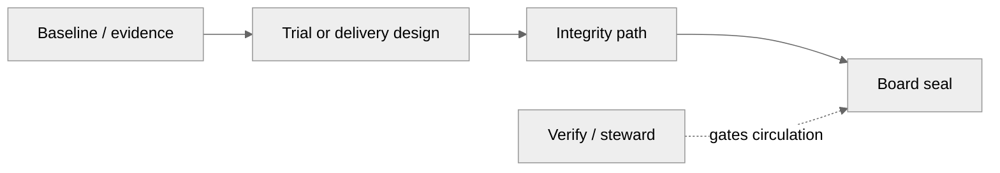

# Delivery dependency view

No invented dates. List Verify / steward siblings when they gate circulation.

| Field | Value |
|---|---|
| Owner | |
| Exhibit id / locked | |
| Interpretable question | |

## Layout — table (authoritative)

| From | To | Dependency type | Owner of dependency | Date (only if supplied) | [GAP]? |
|---|---|---|---|---|---|
| Baseline study | Pilot design | finish-to-start | | | |
| Integrity pack | Board seal | finish-to-start | | | |
| Verify run | External circulation | finish-to-start | | | |

## Layout — visual

Prepared by: ________  Reviewed by: ________
