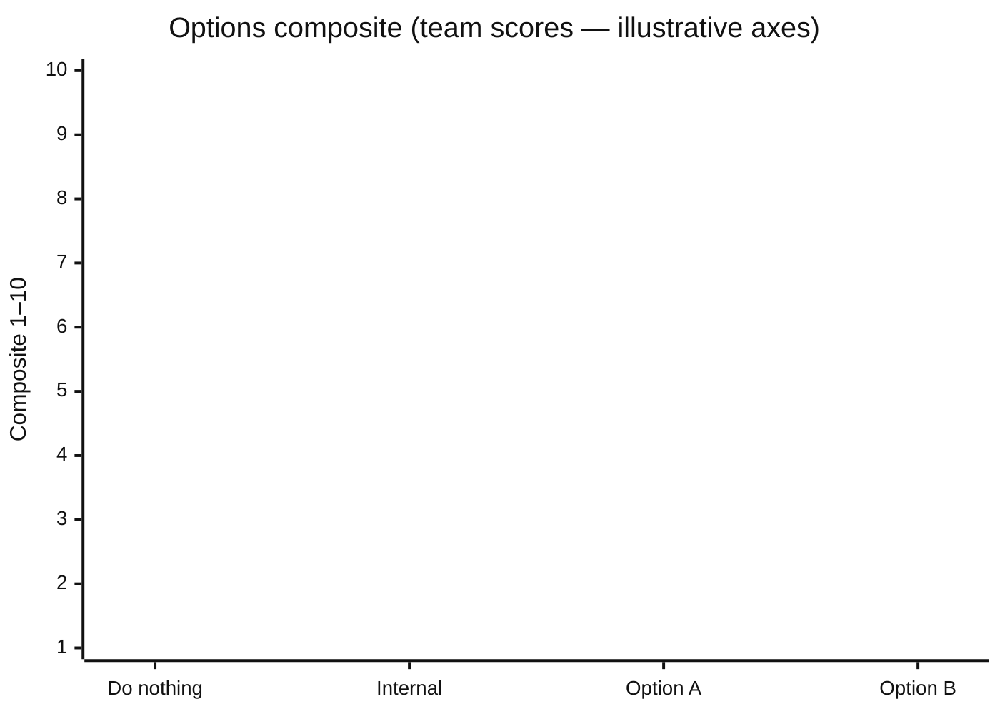

# Options × criteria matrix

Decision-ready exhibit. Every cell is team-entered or `[GAP]`. Assistant never scores.

| Field | Value |
|---|---|
| Owner | |
| Exhibit id | |
| Locked (Y before seal) | |
| Source score-sheet id | |
| Interpretable question | |

## Layout — table (authoritative for numbers)

| Option | Outcome fit | Cost | Time | Reversibility | Risk | Governance | Composite | vs do-nothing | Notes / [GAP] |
|---|---|---|---|---|---|---|---|---|---|
| Do nothing (baseline) | | | | | | | | — | |
| Do it internally (baseline) | | | | | | | | | |
| Option A | | | | | | | | | |
| Option B | | | | | | | | | |

Criterion names must match `compare-options` keys unless the room renamed them with a recorded reason.

## Layout — visual (render for board; values from table only)



Replace bar values only from the locked score sheet. If any cell is `[GAP]`, **withhold** the chart and show the table with gaps named.

```
Composite (high → low)     * = baseline reference (not a contender)
10 |
 9 |                 ██ Option A
 8 |        ██ Int*
 7 | ██ DN*          ██ Option B
 1 +---------------------------
```

Script: `python3 scripts/exhibit_check.py exhibit.json --json`
