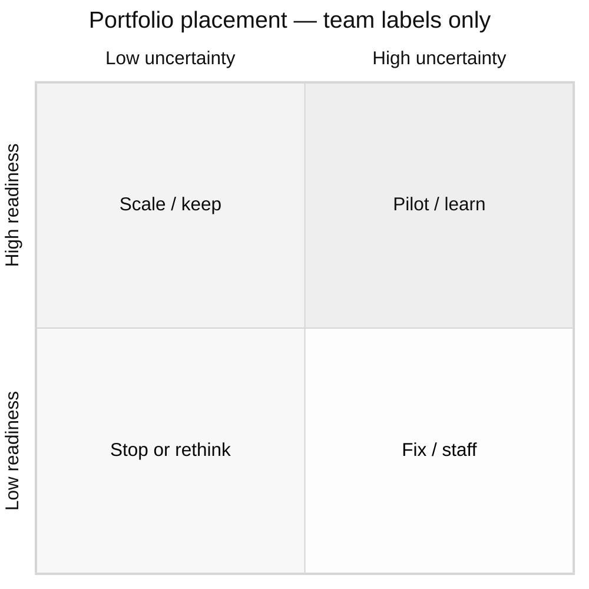

# Portfolio placement exhibit

Team labels only. Not a Launch Pass/Hold gate.

| Field | Value |
|---|---|
| Owner | |
| Exhibit id / locked | |
| Interpretable question | |
| Close vocabulary if used | Proceed / Investigate first / Handle it internally |

## Layout — table (authoritative)

| Initiative | Horizon | Value uncertainty | Capability readiness | Bucket | Notes / [GAP] |
|---|---|---|---|---|---|
| | | | | | |

Baselines (do nothing / do it internally) are **reference lines**, not placed.

## Layout — visual (2×2 grid as text + mermaid)

```
                        Value uncertainty →
                   Low                      High
              ┌────────────────────┬────────────────────┐
 Capability   │  Scale / keep      │  Pilot / learn     │
 readiness ↑  │                    │                    │
              ├────────────────────┼────────────────────┤
              │  Fix / staff       │  Stop or rethink   │
              │                    │                    │
              └────────────────────┴────────────────────┘
```



Plot points only after humans assign coordinates. If Pass/Conditional/Hold is requested, **stop** and hand off to Launch Navigator.
