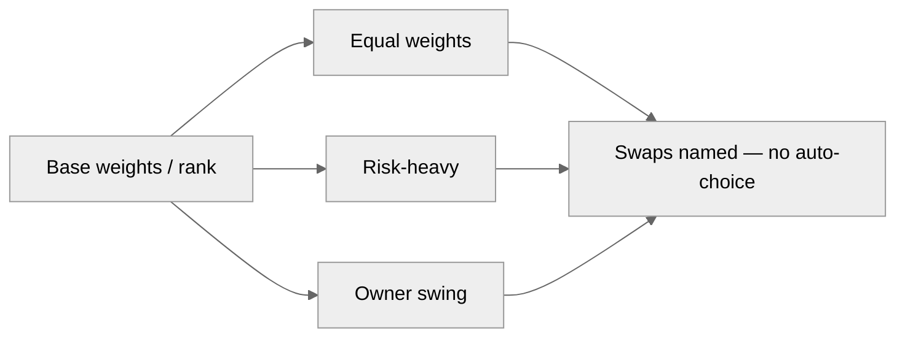

# Sensitivity tornado (weight swings)

People set weights; sensitivity scripts recompute ranks only. Do not crown a winner in the title.

| Field | Value |
|---|---|
| Owner | |
| Exhibit id / locked | |
| Interpretable question | |
| Base rank (from script) | |

## Layout — table (authoritative)

| Swing set | Weights (must sum 1.0) | New rank | Swaps vs base | Requested by |
|---|---|---|---|---|
| Base | | | — | |
| Equal | | | | |
| Risk-heavy | | | | |
| Other | | | | |

Stability narrative (diagnostic, not a recommendation): ________

## Layout — visual



```
Swing          favors left <---|---> favors right
Equal          ########|##
Risk-heavy     ##|##########
Owner swing    |####
```

Script: `python3 scripts/exhibit_check.py exhibit.json --json`
