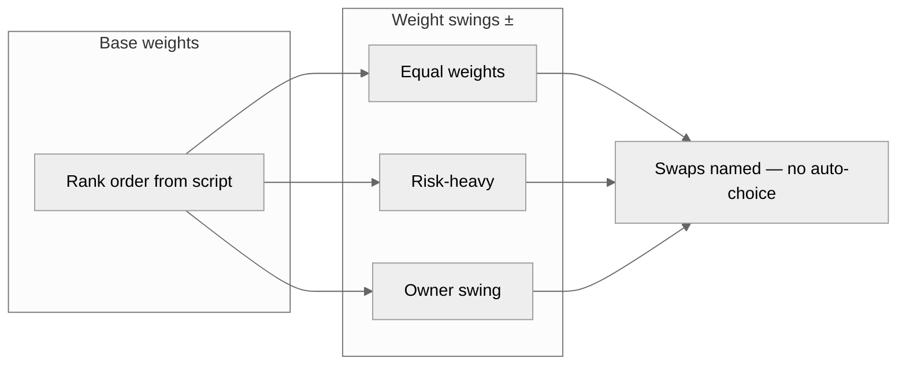

# Sensitivity tornado (weight swings)

People set weights; `sensitivity_exhibit.py` / `run-weight-sensitivity` recomputes ranks only. Do not crown a winner in the title.

| Field | Value |
|---|---|
| Owner | |
| Exhibit id / locked | |
| Interpretable question | |
| Base rank (from script) | |

## Layout — table (authoritative)

| Swing set | Weights (must sum 1.0) | New rank | Swaps vs base | Requested by |
|---|---|---|---|---|
| Base | | | — | |
| Equal | | | | |
| Risk-heavy | | | | |
| Other | | | | |

Stability narrative (diagnostic, not a recommendation): ________

## Layout — visual (tornado of rank movement)



ASCII tornado (one row per swing; bar length = |Δ composite or rank steps|; direction = who moves):

```
Swing          favors left ←——|——→ favors right
Equal          ████████|██
Risk-heavy     ██|██████████
Owner swing    |████
```

Never title this “recommended option.” Script: `python3 scripts/exhibit_check.py exhibit.json --json`
