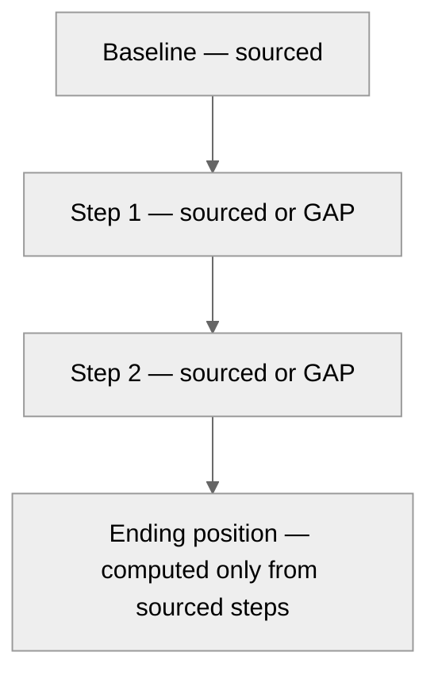

# Value waterfall — only if baseline is present

If baseline is missing, **withhold** this chart and use an options matrix instead.

| Field | Value |
|---|---|
| Owner | |
| Baseline source id / date | |
| Baseline present (Y/N) | |
| Exhibit id / locked | |
| Interpretable question | |

## Layout — table (authoritative)

| Step | Label | Value | Unit | Source id | Class M/V/H/O |
|---|---|---|---|---|---|
| 0 | Baseline | | | | |
| 1 | | | | | |
| 2 | | | | | |
| n | Ending position | | | | |

Title must not claim “savings realized” unless class M/V with source.

## Layout — visual



ASCII waterfall (replace figures from table; leave blank if GAP):

```
Baseline     ████████████  ____
+ Step 1     ██            ____
− Step 2       ████        ____
Ending       ██████████    ____
```

Script flags: baseline_required + not baseline_present → gap (withhold).
